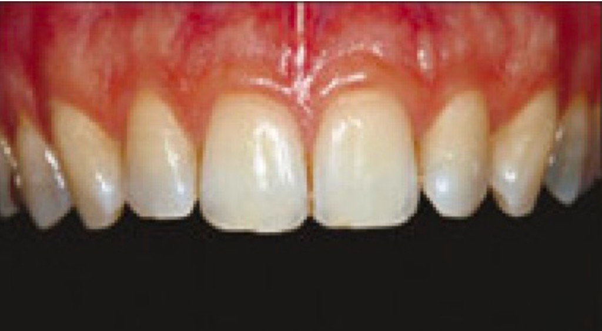
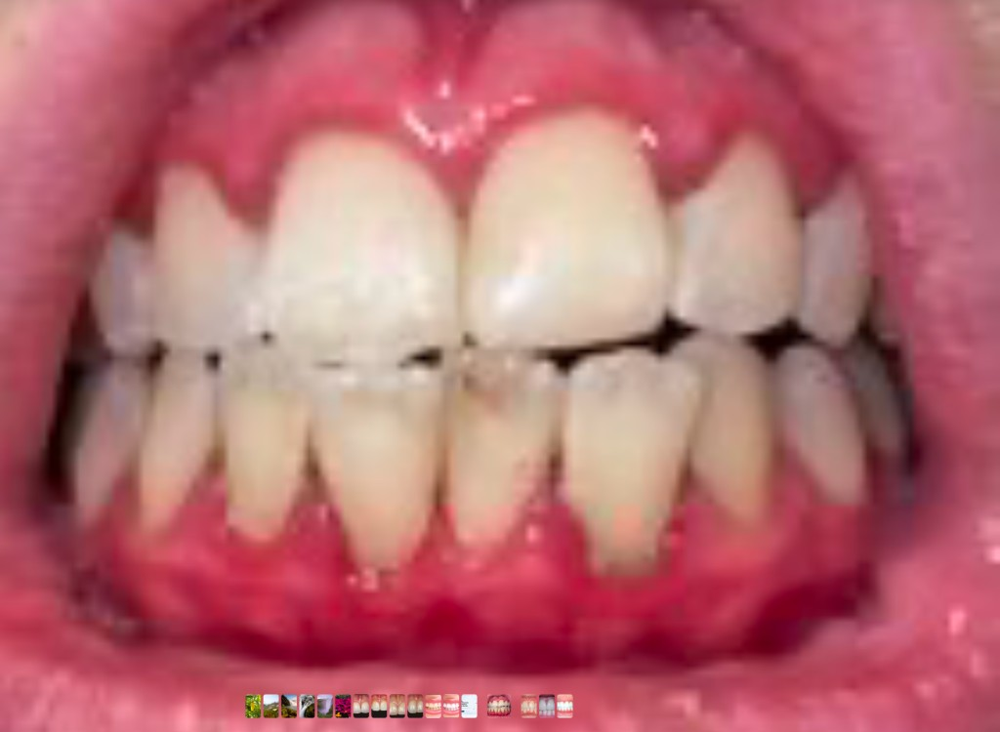
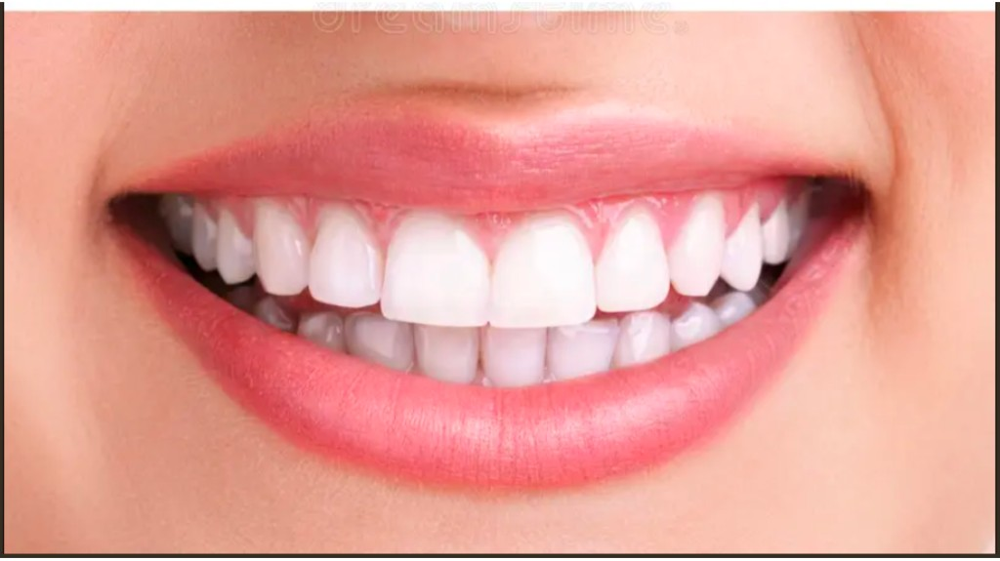

# Client decision needed — Tooth detection & shade matching

**From:** Muhammad  
**To:** Erlan  
**Date:** 29 Sep 2026  
**Status:** Blocking final AI training / polish before project completion  

---

Hi Erlan,

Shade detection in the latest build is working as accurately as we can get it with the current approach. To finish tooth detection and lock shade behaviour for production, we need two clear decisions from you. Without these, we cannot train the model for how dentists will actually photograph patients in the clinic.

Please reply with your choice for **Decision A** and **Decision B** below.

---

## Decision A — How will tooth photos be taken? (required for AI training)

For tooth detection, the AI must be trained on images that match **exactly** how the app will be used chairside. Different photo styles need different training data. If we train on one style and dentists shoot another, detection quality will drop.

Please tell us which style is the real workflow (or if both will be used).

### Style 1 — Clinical close-up (upper teeth only)

Tight crop of the front upper teeth. Gums visible at the top, dark background behind the biting edges. Straight-on, clinical framing.



**Typical of:** retracted / intraoral-style shot, focus on one arch.

### Style 2 — Open-mouth front view (upper + lower)

Wider shot of the open mouth showing both upper and lower front teeth, lips at the edges, more like a phone / chairside photo. Lighting and sharpness can vary more.



**Typical of:** quick chairside capture with both arches in one frame.

### Style 3 — Aesthetic smile (optional reference)

Natural smile with lips framing the teeth. Clean, well-lit, both arches partly visible. Useful as a “best case” reference, but may not match day-to-day clinic photos.



### What we need from you (Decision A)

Please answer:

1. **Which style will dentists use in production?**  
   - Style 1 only  
   - Style 2 only  
   - Both Style 1 and Style 2 (we will train for both)  
   - Something else (please describe or send 5–10 real clinic samples)

2. **Rules for capture** (even rough answers help):  
   - One arch or both arches in one photo?  
   - Retractors / cheek retractors required, or freehand phone photo OK?  
   - Always front-facing, or also side / occlusal views?  
   - Preferred distance / framing (e.g. “front 6–8 teeth fill most of the frame”)

3. **Sample photos from your clinic** (strongly preferred):  
   Please send **10–20 real photos** taken the same way dentists will use the app — good examples and a few imperfect ones (slight blur, flash glare, uneven light). That lets us train and validate properly instead of guessing from stock images.

Until we know the exact capture style, we cannot finalise tooth-detection training for production.

---

## Decision B — Shade matching: keep 3-part zones, or one shade per tooth?

### Current behaviour (latest build)

The latest build is already as accurate as we can make it with this method:

- Each detected tooth is split into **3 zones**: cervical (near gum), middle, and incisal (biting edge).  
- Shade is matched **separately** for each zone (VITA Classical).  
- This matches how natural teeth really look (more yellow near the gum, lighter / more translucent at the edge).

Camera lighting and phone colour still limit absolute accuracy — flash glare and white balance affect all phone-based shade systems. Within those limits, the 3-zone approach is working well.

### Option B1 — Keep 3-part shade (recommended if you want clinical detail)

| Pros | Cons |
|------|------|
| Closer to how labs / dentists describe shade | Slightly more complex UI (3 values per tooth) |
| Handles natural colour gradient on one tooth | Needs a clear, well-framed photo |
| Already implemented and tuned in the latest build | |

### Option B2 — One shade for the whole tooth

| Pros | Cons |
|------|------|
| Simpler result for the dentist (one shade per tooth) | Loses cervical / middle / incisal detail |
| Faster to read on screen | Less useful when shade varies along the tooth |
| Easier for some lab workflows | Would need a product change from current build |

### What we need from you (Decision B)

Please choose one:

- **B1 — Keep 3-part** (cervical / middle / incisal) as in the latest build  
- **B2 — Switch to one shade per whole tooth**  
- **B3 — Hybrid:** show one primary shade per tooth, but keep 3-part available when the dentist expands a tooth  

Also confirm:

4. Should gum shade (G1–G5) stay as it is today?  
5. Any lab / CAD export format that expects a **single** shade code per tooth (so we should not send three zones)?

---

## Why this matters for finishing the project

| Topic | Without your answer | With your answer |
|-------|---------------------|------------------|
| Tooth detection | We cannot train for the real photo style | We train and lock the model for production photos |
| Shade UX | We keep guessing between 3-part vs whole tooth | We ship the behaviour you want and stop changing it |
| Timeline | AI polish stays open-ended | We can complete these items and close the AI scope |

---

## Short reply template (copy/paste)

```
Decision A — Photo style:
  [ ] Style 1 only
  [ ] Style 2 only
  [ ] Both Style 1 and Style 2
  [ ] Other: _______________

Capture notes:
  - One arch / both arches: _______________
  - Retractors required? Yes / No
  - Views needed: front only / also side / also occlusal
  - Sample clinic photos: attached / coming by _______________

Decision B — Shade:
  [ ] B1 Keep 3-part (cervical / middle / incisal)
  [ ] B2 One shade per whole tooth
  [ ] B3 Hybrid (one primary + optional 3-part)

Gum shade G1–G5: keep / change
Lab export expects single shade per tooth? Yes / No
```

Thanks,  
Muhammad

---

## Internal notes (do not send to client)

- Style 1 = `client-decisions/sample-image1-clinical-upper.jpg`  
- Style 2 = `client-decisions/sample-image2-open-mouth.jpg`  
- Style 3 = `client-decisions/sample-image3-smile.jpg` (reference only)  
- Current product: 3-zone shade per tooth + gum G1–G5 (see `docs/SHADE_DETECTION_HOW_IT_WORKS.md`)  
- Prefer recommending **B1** unless the client’s lab workflow requires a single code.
